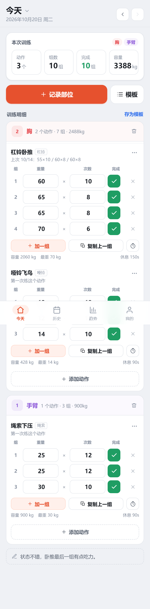
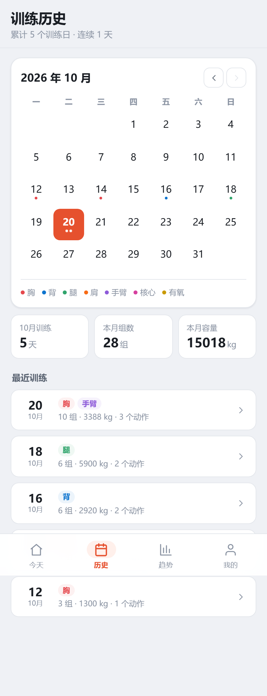
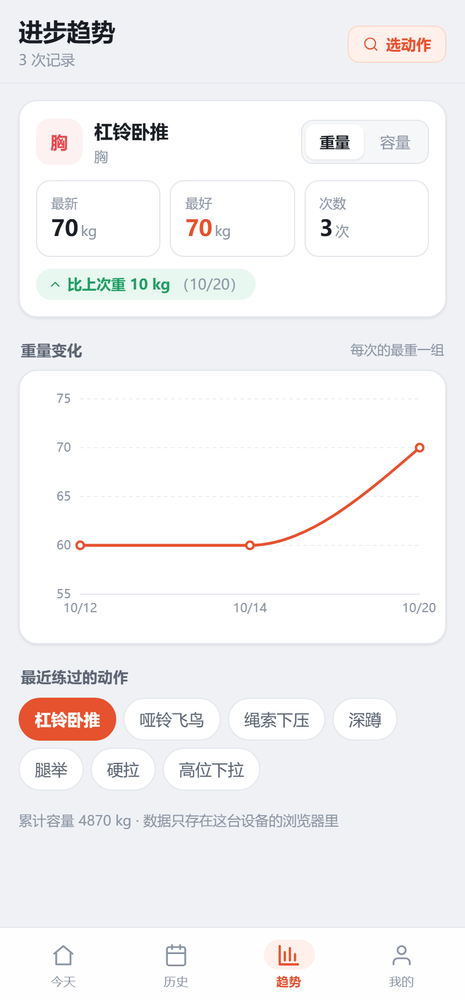

# 健身日志

记录每天练了哪些部位、做了哪些动作、每组多重多少次。本地优先：数据只存在你这台设备的浏览器里，不联网、不上传。

## 怎么用

### 在这台电脑上

```bash
pnpm install     # 第一次
pnpm dev         # 开发模式，浏览器打开 http://127.0.0.1:5173
```

想长期使用、不每次开终端：

```bash
pnpm build       # 生成 dist/ 静态文件
pnpm preview     # 本地预览构建产物（默认 4173 端口）
```

### 在手机上（同一个 Wi-Fi）

1. 电脑上保持 `pnpm dev` 运行
2. 手机浏览器打开 **http://192.168.5.16:5173**
3. 想要像 App 一样：iPhone 用 Safari「分享 → 添加到主屏幕」；Android 用 Chrome 菜单「安装应用 / 添加到主屏幕」

> 注意：`127.0.0.1` 和 `192.168.x.x` 在浏览器看来是**两个不同站点**，数据不互通。
> 决定用哪个地址当主入口后，就一直用那个，别来回换。换端口同理（5173 ≠ 4173）。

## 界面预览





## 功能

| 页面 | 能做什么 |
|---|---|
| **今天** | 选部位 → 选动作 → 逐组填重量/次数 → 打勾完成；自动开始组间休息倒计时（可暂停/+15s） |
| **历史** | 月历上训练日按部位显示彩点；点某天看明细，可复制到「今天」 |
| **趋势** | 选任意动作，看最重重量 / 总容量随时间的折线图，以及相对上次的变化 |
| **我的** | 自定义动作、训练模板、休息时长与提示音、导出/导入备份 |

- **模板**：记录完一次训练 → 训练明细右上角「存为模板」，下次在「模板」面板一键套用
- **推荐模板**：「我的 → 我的模板 → + 载入推荐模板」可一键加入「推日 / 拉日 / 腿日 / 全身」四套起点模板，之后可在模板面板里删改
- **复制上次**：今天页空白时的「复制上次训练」，或模板面板里的「复制历史训练」
- **撤销**：误删动作或改错数字，点底部「撤销」（桌面端也支持 Ctrl/Cmd+Z）
- **预置动作库**：38 个常见动作。找不到就在「添加动作」面板底部新建

## 数据与备份

- 存储位置：浏览器 `localStorage`，键名 `gym-log:data`
- 清理浏览器缓存 / 换浏览器 / 用无痕模式 → 数据会丢
- 建议每隔一段时间在「我的 → 导出备份」存一个 JSON 文件

## 技术栈

React 19 + TypeScript + Vite 8，图表用 Recharts（趋势页按需加载）。
纯前端，无后端、无账号、无网络请求。

## 目录

```
src/
  types.ts              数据模型（日期 → 部位 → 动作 → 组）
  data/                 部位、预置动作库、子部位关键词
  lib/store.ts          全部读写操作（纯函数）+ 持久化 + 导入导出
  lib/utils.ts          日期、数字、格式化
  state/gym.tsx         全局状态：reducer + 撤销栈 + URL 同步
  components/           部位块、动作选择器、日历、休息计时器、图表
  pages/                今天 / 历史 / 趋势 / 我的
scripts/                端到端测试、截图、图标生成
```

## 开发脚本

```bash
pnpm typecheck          # 类型检查
pnpm build              # 构建到 dist/
node scripts/e2e.mjs    # 真实浏览器点一遍核心流程（需要先 pnpm dev）
node scripts/visual.mjs # 注入示例数据并截图到 .shots/ui/
```
## 常见问题

**手机上打不开？**
手机和电脑要连同一个 Wi-Fi；公司/学校网络有时会隔离设备，换成手机热点再试。

**换手机 / 清理缓存后数据没了？**
数据在浏览器本地，换设备不会自动同步。用「我的 → 导出备份」，在新设备上「导入备份」。

**更新代码后数据还在吗？**
在。数据存在浏览器的 localStorage，和代码文件无关；除非你手动点了「清空全部数据」。

**想改练法 / 加动作？**
动作在「添加动作」面板底部可以直接新建；整套流程在「我的 → 我的模板」里管理。
